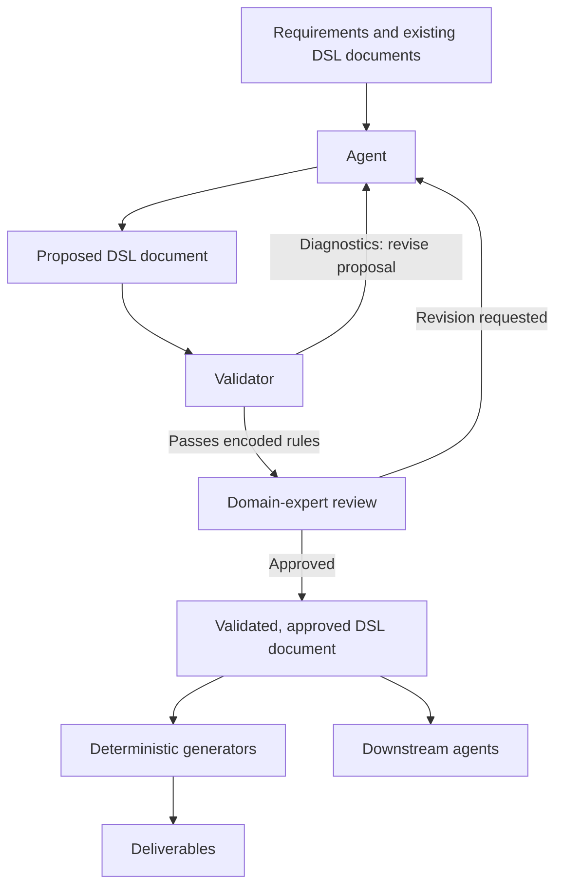

# DSL-mediated Agents: A Definition

Steve Livengood | October 2026

> __DSL-mediated Agents__ are AI agents that read and write documents in a well-defined domain-specific language (DSL)
> rather than free-form text, so that their work can be formally validated, reviewed by human experts, turned into artifacts
> by deterministic generators, or passed cleanly to downstream agents.

## Summary

__The problem__: AI agents reason in a non-deterministic way and usually communicate in free-form text or loosely
structured output. That makes their work hard to check, hard to review, hard to reproduce, and hard to hand from one
agent (or one tool) to the next. Teams end up reading prose or diffing generated code and hoping nothing subtle went wrong.

__The idea__: Give the agent a precise language to work in. Instead of asking an agent to produce arbitrary text or
code, define a DSL that captures the intent of a domain (an API surface, a workflow, a configuration, a model of a
system) and make that language the medium through which agents and humans collaborate. The agent's non-deterministic
reasoning is still there, but its output lands in a form that deterministic machinery can check and process.

A DSL is a language specialized to a domain. A DSL document is one expression of it: a particular design, policy, plan,
or other domain description. In the _DSL-mediated Agents_ pattern, agents create and revise DSL documents, while
validators, domain experts, and downstream tools check, review, and process them.

## The pattern

A DSL-mediated Agent system centers on a domain language whose DSL documents agents can read and write, machinery can
validate, and domain experts can review directly. The following five parts describe a reference architecture for putting
that approach into practice.

1. __A well-defined domain language__. A DSL with an explicit grammar and meaning (semantics), designed for the domain
   rather than for general programming.
2. __Agents that read and write DSL documents__. Agents can read and produce DSL documents. Their inputs may
   also include natural-language requirements; they do not communicate their results only as free-form text.
3. __Formal validation__. Parsers, type checks, and constraint checkers verify every agent-produced DSL document against
   the language's syntax and encoded domain rules before anyone relies on it. Passing validation establishes conformance
   to those rules, not that the DSL document satisfies the intended requirements.
4. __Human review in the loop__. The DSL represents domain concepts in a form designed for domain experts to read and
   assess directly. Language workbenches, IDEs, and web editors let those experts check whether an agent's proposed DSL
   document captures the intended requirements, and edit or approve it in the domain's own terms.
5. __Deterministic downstream processing__. Model transformations, compilers, and artifact generators turn validated DSL
   documents into deliverables such as code, documentation, configuration, and SDKs. Given the same DSL documents, toolchain
   versions, configuration, and other declared inputs, these transformations produce the same outputs. Downstream agents
   can also consume DSL documents directly.

The diagram below shows that validation steps check encoded rules; domain experts assess intended meaning.
Generators and downstream agents consume the same validated, approved version of a DSL document; any later edit, by
human or agent, restarts the loop. Systems without mandatory human approval can proceed after successful validation.



__The key property__: _agent output becomes something you can check, review, and build on_.

## What it is not

- __Not a language for governing agents__. Some projects define DSLs that monitor or constrain what an agent may do
  at runtime, such as AgentSpec [6]. Those languages guard the agent. In a DSL-mediated Agent system, the DSL is what
  the agent writes: a document describing the domain itself, which validators, experts, and generators then work on.
- __Not just structured output__. Producing valid JSON or conforming to a schema is not enough. The shared language must
  express domain concepts with explicit semantics and rules, in a notation designed for domain experts to read, review,
  and edit directly.
- __Not agents writing arbitrary general-purpose code__. Code can be a downstream product of the process, but it isn't
  the shared medium.

## A worked example (illustrative)

This example is only illustrative. The notation, volumes, limits, and reagents are invented to show the pattern. They are
not intended to reflect real laboratory practice or any real equipment.

Suppose a researcher asks an agent to prepare a protocol for an automated liquid-handling robot:

> _Make a six-point two-fold dilution series of sample S1 in a 96-well plate, add the developing reagent, incubate for
> 15 minutes at 37 C, and read absorbance at 450 nm._

The agent could translate this prose directly into the robot's low-level instructions. A fragment might look like this:

```text
PICKUP_TIP     rack=T1 pos=A1
ASPIRATE       labware=res1 well=A1 volume=50 uL rate=150 uL/s
DISPENSE       labware=plate1 well=A2 volume=50 uL rate=150 uL/s
DROP_TIP       waste=W1
PICKUP_TIP     rack=T1 pos=A2
...
```

A complete protocol would run to hundreds of such lines. These instructions expose individual machine operations rather
than the experimental design. Reviewing hundreds of them makes it much harder for a scientist to confirm that the protocol
matches the request. Instead, the agent produces a DSL document in a notation designed for the scientist:

```text
protocol "Dilution series and readout"
labware plate96 (max well volume 200 uL)

step dilute
  add 90 uL "Buffer A" to wells A2-A6
  add 100 uL "Sample S1" to well A1
  serial transfer 10 uL from A1 to A6, mixing 3 times at each well

step develop
  add 120 uL "Reagent B" to wells A1-A6
  incubate 15 min at 37 C

step read
  measure absorbance at 450 nm in wells A1-A6
```

Here, "serial transfer" means transferring the stated volume successively between adjacent wells, mixing each receiving
well before the next transfer, and retaining the final transfer in A6.

1. __Validation catches a mechanical error.__ Adding 120 uL of Reagent B would bring wells A1-A5 to 210 uL and well A6 to
   220 uL, above the 200 uL limit. The validator rejects the document and returns a diagnostic, and the agent revises the
   amount to 100 uL.
2. __Review catches an error of intent.__ The revised document passes every check, but the scientist reading it sees that
   transferring 10 uL into 90 uL of buffer makes a ten-fold series, not the two-fold series requested. The validator checks
   the protocol against its encoded rules, but the requested dilution factor has not been encoded as a requirement.
   The scientist catches the mismatch with the original request. The agent revises the dilution and development steps,
   leaving the rest of the DSL document unchanged:

    ```text
    step dilute
      add 50 uL "Buffer A" to wells A2-A6
      add 100 uL "Sample S1" to well A1
      serial transfer 50 uL from A1 to A6, mixing 3 times at each well

    step develop
      add 100 uL "Reagent B" to wells A1-A6
      incubate 15 min at 37 C
    ```

    A richer DSL might let the scientist state the dilution factor directly, which a validator could then check. This
    one deliberately stays at the level of volumes.

3. __Revision restarts the loop.__ The changed document goes back through validation (every well stays at or below 200 uL)
   and is approved by the scientist.
4. __Deterministic generators process the approved document.__ They produce the detailed instruction set for the robot,
   along with a reagent pick list and a human-readable protocol sheet. Given the same approved document, the same
   toolchain versions, and the same equipment configuration, they produce the same instructions every time.

The scientist reviewed a handful of lines, not hundreds of pipetting moves. Volume limits and similar rules were checked
by machine, and the approved document remains the single record of what was intended.

DSL documents provide a shared basis for automated validation, domain-expert review, and reproducible artifact generation.
Downstream agents (not shown in this example) receive an explicit domain model rather than having to reconstruct it
from prose.

## Related ideas

The constituent parts of this pattern are not new. It sits where several established lines of work meet, and each is worth
understanding.

__Model-driven engineering.__ For decades, teams have defined small languages for a domain, built editors so experts
can work in them, and generated software from the results. A recent review of how these practices apply to AI focuses
on using them to engineer AI systems [1]. DSL-mediated Agents point the other way: the AI becomes a _user_ of the
language.

__DSLs and LLMs.__ Practitioners and researchers have noticed that DSLs suit language models. Unmesh Joshi, writing on
Martin Fowler's site, observes that a DSL leaves little room for variation and usually comes with a validator, so an
agent can generate a candidate, check it, and repair it from error messages phrased in the domain's own terms, without
a human in the loop. He also argues that the DSL, not the prompt, becomes the lasting artifact people maintain [2]. A
NeurIPS 2026 paper makes a related case: the choice of language and verifiers deserves deliberate design, because it
shapes what an agent can do and how it fails [3]. At the syntax level, grammar masking shows that a model's output can
be restricted to a DSL's grammar so that it is always well-formed [4]. A study of generating Linux authorization rules
found that putting the grammar and vocabulary in the prompt pushed syntactic validity to about 99%, yet when experts
reviewed a sample of rules that had passed the automated checks, a few percent still did not mean what was asked [5].

__Languages that guard agents.__ Other work uses DSLs to constrain what an agent is allowed to do. AgentSpec, for
example, lets users write rules that are checked while an agent runs, such as "ask a person before this transfer" [6].
In this case, the DSL governs how the agent _behaves_; with DSL-mediated Agents, the DSL defines how the agent _communicates_.

__Laboratory automation.__ The closest cousins come from lab automation, where a model turns a plain-language protocol
into something a robot can execute. One recent framework has an agent formalize the protocol into a structured
representation, a rule-based engine map it onto device commands, and a second agent check the result and trigger
corrections [7]. A survey of AI-driven science warns that generating robot commands straight from prose is unsafe
without checks like these [8]. In that framework the intermediate form is mostly a structure for software to work
with. What this page emphasizes is a notation that experts can read, question, and approve before anything runs.

__Rules as Code.__ Rules as Code efforts turn policy and legislation into executable rules. Experiments using language
models for this have found that they can help, but that complex policies still need expert human oversight [9]. It is
the same loop with a different cast.

What this page adds is a name and an emphasis. The ingredients exist. The claim is that putting an expert-readable
domain language between the agent and the deterministic tools is a useful pattern across many fields.

## Open questions

- How should a DSL be designed so that agents can use it reliably (grammar size, error messages, examples)?
- What is the right division of labor between agent, validator, and human reviewer?
- How should DSLs evolve safely when agents propose extensions to the language itself?
- How do you measure whether a DSL-mediated Agent system is more reliable than a free-form one?

## References

1. Rädler, S., Berardinelli, L., Winter, K., Rahimi, A., & Rinderle-Ma, S. (2025).
   [Bridging MDE and AI: a systematic review of domain-specific languages and model-driven practices in AI software
   systems engineering](https://link.springer.com/article/10.1007/s10270-024-01211-y). _Software and Systems
   Modeling_ volume 24, pp 445–469.
2. Joshi, U. (2026, July 14).
   [DSLs Enable Reliable Use of LLMs](https://martinfowler.com/articles/llm-and-dsls.html). martinfowler.com.
3. Li, L., Jiang, W., Yang, X., Xie, S., Gu, C., Meng, Y., He, Z., & Wang, Z. (2026).
   [Treat Domain-Specific Languages as Design Variables in LLM Agents](https://neurips.cc/virtual/2026/poster/140069).
   NeurIPS 2026 (poster). _Based on the published abstract; full text not yet available._
4. Netz, L., Reimer, J., & Rumpe, B. (2024).
   [Using Grammar Masking to Ensure Syntactic Validity in LLM-based Modeling Tasks](https://arxiv.org/abs/2407.06146).
   MODELS Companion '24 (workshop on AI and model-driven engineering). arXiv:2407.06146.
5. Kozachok, A., Nazimov, A., & Magomedov, S. (2026).
   [Text2DSL: LLM-Based Code Generation for Domain-Specific Languages](https://arxiv.org/abs/2606.22586).
   KES 2026, _Procedia Computer Science_. arXiv:2606.22586.
6. Wang, H., Poskitt, C. M., & Sun, J. (2026).
   [AgentSpec: Customizable Runtime Enforcement for Safe and Reliable LLM Agents](https://arxiv.org/abs/2503.18666).
   ICSE '26. arXiv:2503.18666.
7. Choi, H., Kim, J. Y., Lim, H., & Jeon, S. (2026).
   [Dual-Agent Framework for Cross-Model Verified Translation of Natural-Language Protocols into Robotic Laboratory
   Platform](https://arxiv.org/abs/2606.20120). arXiv:2606.20120.
8. King, R. (2026).
   [The Past and Future of AI Scientists](https://arxiv.org/abs/2608.14407). arXiv:2608.14407.
9. Kennan, A., Singh, L., Garcia Guevara, A., Ahmed, M., & Goodman, J. (2025).
    [AI-Powered Rules as Code: Experiments with Public Benefits Policy](https://digitalgovernmenthub.org/library/ai-powered-rules-as-code-experiments-with-public-benefits-policy/).
    Digital Government Hub.

## Use and attribution

The term "DSL-mediated Agents" is free for anyone to use, with no permission needed. If you use or discuss it, a reference
back to this page is appreciated.

This work is licensed under [Creative Commons Attribution 4.0 International (CC BY 4.0)](https://creativecommons.org/licenses/by/4.0/).
You are free to share and adapt it, including commercially, as long as you give appropriate credit to the author.

__Suggested citation__: Steve Livengood. "DSL-mediated Agents: A Definition." 2026.
[https://doi.org/10.5281/zenodo.23587494](https://doi.org/10.5281/zenodo.23587494) or
[https://github.com/thirdrailsoftware/dsl-mediated-agents/blob/main/definition.md](https://github.com/thirdrailsoftware/dsl-mediated-agents/blob/main/definition.md).

\#DSLMediatedAgents
